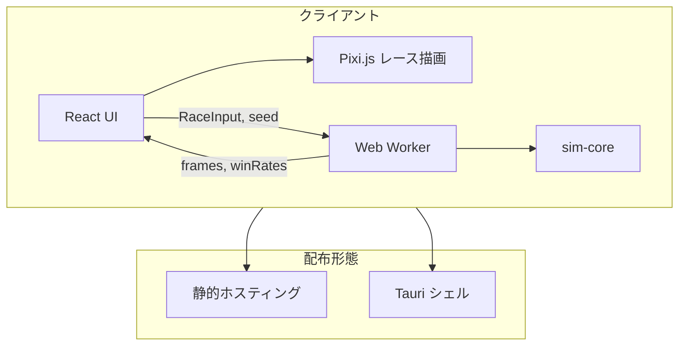
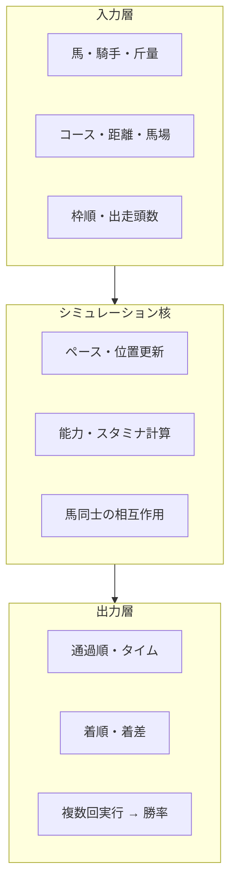

# KEIBA RACING SIMULATOR 基本設計書

| 項目 | 内容 |
|------|------|
| 文書名 | 基本設計書 |
| プロジェクト | KEIBA RACING SIMULATOR |
| 版 | 0.1.0 |
| 作成日 | 2026-06-14 |
| ステータス | 草案 |

---

## 1. 概要

### 1.1 目的

本プロジェクトは競馬レースのシミュレータを開発する。主目的は **予想支援**（勝率・着順分布の算出）とし、副目的として **レース展開の GUI による動的可視化**（位置・ペースの時系列表示）を提供する。

### 1.2 スコープ

| 対象 | 内容 |
|------|------|
| 含む | 能力モデル、レース進行シミュレーション、Monte Carlo 予想、レース再生 GUI |
| 含まない（初期） | 実データ自動取得、機械学習校正、オッズ連携、3D 表現 |

### 1.3 非機能要件

| 要件 | 方針 |
|------|------|
| 再現性 | seed 固定により同一入力で同一結果を得られる |
| 配布形態 | Web 公開とデスクトップ配布の両方に低コストで移行可能な設計 |
| パフォーマンス | Monte Carlo（1,000 回程度）を Web Worker で非同期実行 |
| 保守性 | シミュレーション核と UI を分離したモノレポ構成 |

---

## 2. システム構成

### 2.1 採用方針：ルート A（TypeScript 一本）

シミュレーション処理を TypeScript で実装し、フロントエンドと共通の型・ロジックを共有する。Python 等の外部 API は初期段階では採用しない。

**選定理由**

- 予想（数値計算 + 乱数 + 状態更新）は TypeScript で十分実装可能
- Web / デスクトップで同一コードを実行でき、二重保守を避けられる
- 静的ホスティングのみで Web 公開可能（サーバー運用不要）
- 将来 Python API を追加する場合も、インターフェースを合わせれば移行可能

### 2.2 技術スタック

| レイヤ | 技術 | 用途 |
|--------|------|------|
| シミュレーション核 | TypeScript | 能力計算、レース進行、Monte Carlo |
| 型・バリデーション | TypeScript + Zod（任意） | 入力データの型安全・検証 |
| フロントエンド | React + TypeScript + Vite | UI |
| レース描画 | Pixi.js または Konva | コース上の馬アニメーション |
| 予想グラフ | Recharts または Chart.js | 勝率・着順分布 |
| 状態管理 | Zustand | レース状態・予想結果 |
| 非同期処理 | Web Worker | Monte Carlo（UI ブロック回避） |
| デスクトップ（将来） | Tauri 2 | Web ビルドのラッピング |
| パッケージ管理 | pnpm（ワークスペース） | モノレポ |
| テスト | Vitest | sim-core ユニットテスト |

### 2.3 配布形態と移行設計

Web 公開とデスクトップインストーラ配布のどちらにも低コストで移行できるよう、**同一 React アプリを異なる「殻」で包む**設計とする。

```
┌─────────────────────────────────────┐
│  共通資産（1 セットのみ開発）        │
│  packages/sim-core + apps/web (UI)  │
└─────────────────────────────────────┘
           │                │
     ┌─────┴─────┐    ┌─────┴─────┐
     │ Web 公開   │    │ Desktop   │
     │ 静的ホスト │    │ Tauri     │
     └───────────┘    └───────────┘
```

**移行原則**

1. シミュレーションは `packages/sim-core` に集約する
2. UI に Web / Desktop 固有の処理を直書きしない（アダプタ層で吸収）
3. 設定は環境変数 + ランタイム検出（`VITE_*`、Tauri 判定）

**プラットフォーム差分のアダプタ例**

| 機能 | Web | Desktop |
|------|-----|---------|
| 設定保存 | localStorage / IndexedDB | Tauri fs plugin |
| ファイル読込 | ブラウザ upload | ネイティブファイル選択 |

---

## 3. アーキテクチャ

### 3.1 全体構成図



### 3.2 モノレポ構成

```
KEIBA_RACING_SIMULATOR/
├── packages/
│   ├── sim-core/              # シミュレーション核
│   │   ├── src/
│   │   │   ├── models/        # 型定義
│   │   │   ├── input/         # 初期化・適性補正
│   │   │   ├── physics/       # 速度・スタミナ
│   │   │   ├── pace/          # 脚質・ペース
│   │   │   ├── interaction/   # 馬同士の相互作用
│   │   │   ├── engine/        # tick, simulate
│   │   │   ├── output/        # 着順・通過・着差
│   │   │   ├── monteCarlo.ts
│   │   │   └── rng.ts
│   │   └── tests/
│   ├── shared-types/          # 共有型（任意：sim-core に統合可）
│   └── platform/              # StorageAdapter 等
├── apps/
│   ├── web/                   # Vite + React（メイン UI）
│   └── desktop/               # Tauri（将来追加）
└── doc/
    ├── README.md
    └── basic-design.md        # 本文書
```

### 3.3 シミュレーション 3 層モデル

シミュレーションは入力層・核・出力層の 3 層で構成する。



| 層 | 責務 | 主要モジュール |
|----|------|----------------|
| 入力層 | レース条件・出走馬データの受け取りと正規化 | `input/`, `models/` |
| シミュレーション核 | 時間経過に伴う状態更新 | `physics/`, `pace/`, `interaction/`, `engine/` |
| 出力層 | 結果の集約と Monte Carlo | `output/`, `monteCarlo.ts` |

---

## 4. ドメインモデル

### 4.1 馬（Horse）

| 属性 | 型 | 説明 |
|------|-----|------|
| id | string | 馬 ID |
| speed | number | 最高速（0–100 等の正規化値） |
| stamina | number | スタミナ |
| acceleration | number | 出足・加速 |
| cornering | number | コーナー性能 |
| runningStyle | enum | 脚質：`front` / `stalk` / `mid` / `closer` |
| aptitudes | object | 芝・ダート・距離適性 |

### 4.2 レース入力（RaceInput）

| 属性 | 型 | 説明 |
|------|-----|------|
| course.surface | `'turf' \| 'dirt'` | 馬場種別 |
| course.distance | number | 距離（m） |
| course.direction | `'right' \| 'left'` | 回り |
| going | enum | 馬場状態：良 / 稍重 / 重 / 不良 |
| entries | Entry[] | 出走表 |

### 4.3 出走エントリ（Entry）

| 属性 | 型 | 説明 |
|------|-----|------|
| horse | Horse | 馬 |
| jockey.skill | number | 騎手能力 |
| weight | number | 斤量（kg） |
| gate | number | 枠番 |
| post | number | 馬番 |

### 4.4 レース状態（RaceState）

| 属性 | 型 | 説明 |
|------|-----|------|
| time | number | 経過時間（秒） |
| segmentIndex | number | 現在区間 |
| horses | HorseState[] | 各馬の動的状態 |

### 4.5 馬状態（HorseState）

| 属性 | 型 | 説明 |
|------|-----|------|
| horseId | string | 馬 ID |
| distance | number | 走行距離（m） |
| speed | number | 現在速度（m/s） |
| staminaLeft | number | 残スタミナ（0–1） |
| lane | number | 内外位置 |
| rank | number | 現在順位 |

### 4.6 レース結果（RaceResult）

| 属性 | 型 | 説明 |
|------|-----|------|
| finishOrder | FinishEntry[] | 着順・タイム・着差 |
| checkpoints | Checkpoint[] | 通過順（距離ごと） |
| frames | SimulationFrame[] | GUI 再生用（任意） |

---

## 5. シミュレーションアルゴリズム

### 5.1 開発段階

段階的に機能を拡張する。

| 段階 | 内容 | 成果物 |
|------|------|--------|
| Phase 1 | 能力スコア + 乱数 → 着順 | 最小シミュレータ |
| Phase 2 | Monte Carlo → 勝率・3着内率 | 予想機能 |
| Phase 3 | 時間ステップ + 区間更新 | 通過順・タイム |
| Phase 4 | 脚質・ペース・相互作用 | 展開の多様化 |
| Phase 5 | 実データによる係数調整 | 精度向上 |

### 5.2 能力計算（S）

各馬の目標速度・スタミナ消費率を、能力値とレース条件から算出する。

**考慮要素**

- 距離適性（適性距離からの偏差）
- 馬場適性（芝 / ダート、馬場状態）
- 斤量補正
- 騎手補正
- 脚質と想定ペースの相性

**速度の概算式（概念）**

```
v(t) = v_max
     × stamina_factor(残スタミナ)
     × corner_factor(コーナー区間)
     × pace_factor(前後の馬との距離)
     × track_condition_factor(馬場状態)
```

### 5.3 ペース・位置更新（P）

離散時間ステップ（例：0.1 秒刻み）または固定距離区間（例：200 m）でレースを進行する。

**1 tick の処理**

1. 現在の位置・順位・残スタミナを取得
2. 脚質と前後関係から目標速度を決定
3. 能力・スタミナ・コース条件から実速度を算出
4. 位置（走行距離）を更新
5. スタミナを消費
6. 順位を再計算

**コース区間（概念）**

```
[スタート] → [第1コーナー] → [向正面] → [第2コーナー] → [直線] → [ゴール]
```

### 5.4 馬同士の相互作用（I）

| 現象 | モデル |
|------|--------|
| 前が詰まる | 前馬との距離 < 閾値 → 速度上限 |
| 外を回る | コーナー外側 → 距離ロス + 減速 |
| 位置取り | 枠・脚質に基づく初期位置（内外・前後） |
| 仕掛け | 残距離・順位に応じた加速（騎手判断） |

### 5.5 ペースシナリオ

先頭馬の速度からレース全体のペースを動的に決定し、脚質ごとに相性ボーナス / ペナルティを適用する。

| ペース | 特徴 | 有利な脚質 |
|--------|------|------------|
| ハイペース | 前半が速い | 差し・追込 |
| スローペース | 後半まで温存 | 逃げ・先行 |
| ミドルペース | 標準的 | 能力通り |

### 5.6 乱数と再現性

- seed 付き PRNG を使用し、`Math.random()` のみには依存しない
- レース単位で seed を指定可能とする
- Monte Carlo では `baseSeed + trialIndex` で各試行を独立かつ再現可能にする

### 5.7 Monte Carlo 予想（M）

同一 `RaceInput` に対して N 回（初期目標：1,000 回）シミュレーションを実行し、各馬の勝率・3着内率・平均着順を算出する。

**パフォーマンス方針**

| モード | frames 記録 | 用途 |
|--------|-------------|------|
| 予想 | なし | Monte Carlo（高速） |
| 再生 | あり | GUI アニメーション（1 回のみ） |

---

## 6. UI 設計

### 6.1 画面構成（概念）

| 領域 | 内容 |
|------|------|
| レース設定 | コース・距離・馬場・出走表入力 |
| レースキャンバス | Pixi.js によるコース・馬位置の描画 |
| 操作 | 再生 / 一時停止 / 速度変更 / 予想実行 |
| 予想パネル | 勝率・3着内率・平均着順・分布グラフ |

### 6.2 動作モード

| モード | 処理 | 表示 |
|--------|------|------|
| 予想モード | Worker で `monteCarlo()` | 勝率・グラフ |
| 再生モード | Worker で `simulateOnce({ recordFrames: true })` | 時系列アニメーション |

### 6.3 Worker 通信

```
UI ──(RaceInput, seed, options)──▶ Worker
Worker ──(progress, winRates)──▶ UI        // 予想
Worker ──(frames, result)──▶ UI            // 再生
```

---

## 7. 将来拡張

### 7.1 デスクトップ版（Tauri）

- `apps/web` のビルド成果物を Tauri が読み込む
- `packages/platform` の Desktop アダプタを追加
- UI・sim-core は変更なし

### 7.2 Python API（必要時）

シミュレーション核のインターフェース（`RaceInput` → `RaceResult`）を維持したまま、実装を Python API に差し替え可能。

| 配布 | API 配置 |
|------|----------|
| Web | クラウド（Fly.io / Railway 等） |
| Desktop | 同梱プロセスを localhost で起動 |

### 7.3 キャリブレーション

過去レースデータを用い、以下の分布に合わせて係数を調整する。

- 距離別平均タイム・標準偏差
- 1 番人気勝率（JRA 参考：約 30% 前後）
- 脚質別勝率分布
- 枠順バイアス

---

## 8. 採用しない技術（初期）

| 技術 | 理由 |
|------|------|
| Unity / Godot | 予想・統計 UI との相性が悪い |
| Streamlit / Dash のみ | 滑らかなレースアニメーションに不向き |
| Pygame のみ | UI・グラフ・保守性で Web 構成に劣る |
| Electron | Tauri の方が軽量。必要時のみ検討 |

---

## 9. 開発ロードマップ

| Phase | 内容 | 成果物 |
|-------|------|--------|
| 1 | モノレポ scaffold、`sim-core` 最小版 | 着順が出る CLI / テスト |
| 2 | `apps/web` 基本 UI + 予想パネル | ブラウザで勝率表示 |
| 3 | Pixi.js レース再生 | 展開の可視化 |
| 4 | 脚質・ペース・相互作用 | 展開の多様化 |
| 5 | Tauri デスクトップ版（任意） | インストーラ |
| 6 | 実データ校正（任意） | 精度向上 |

---

## 10. 用語集

| 用語 | 説明 |
|------|------|
| Monte Carlo | 同一条件で大量にシミュレーションし、確率分布を求める手法 |
| tick | シミュレーションの最小時間単位（1 ステップ） |
| frames | GUI 再生用の各 tick 時点の全馬状態スナップショット |
| 脚質 | 逃げ・先行・差し・追込などの跑法 |
| seed | 乱数生成の初期値。再現性確保に使用 |

---

## 改訂履歴

| 版 | 日付 | 内容 |
|----|------|------|
| 0.1.0 | 2026-06-14 | 初版作成（設計方針・シミュレーション・技術選定） |
