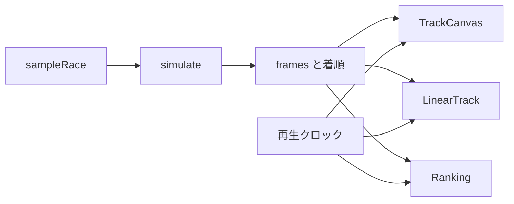

# KEIBA RACING SIMULATOR 基本設計書

| 項目 | 内容 |
|------|------|
| 文書名 | 基本設計書 |
| プロジェクト | KEIBA RACING SIMULATOR |
| 版 | 0.2.2 |
| 作成日 | 2026-06-14 |
| 改訂日 | 2026-10-22 |
| ステータス | プロトタイプ仕様 |

本書はこのプロトタイプを実装するための仕様である。`doc/poc` の検証計画は実装範囲に含めない。

---

## 1. 概要

### 1.1 目的

ブラウザで 1 レースを走らせ、コース上の馬の位置が時間とともに変わる様子を描画する。

着順・着差・タイムは、そのシミュレーションの結果として同じ画面に出す。

### 1.2 完了条件

次をすべて満たした時点でプロトタイプ完了とする。

1. サンプルレースを開くと、楕円コース、直線の走行図、8 頭が描画される
2. 再生すると馬が左回りに動き、直線図ではゴール方向へ進む。順位が途中で入れ替わる
3. 一時停止、最初から、1 倍 / 2 倍 / 4 倍ができる
4. 全馬がゴールすると着順・タイム・着差（馬身）が残る
5. 同じサンプルを二度計算すると、着タイムと全フレームの位置が一致する
6. 逃げが序盤に先頭へ出る。差し・追込は最終直線で順位を上げる。外レーンの馬はコーナーで内側よりレース距離の進みが遅い

### 1.3 対象

| 対象 | 内容 |
|------|------|
| 作る | 固定サンプル 1 レース、0.1 秒刻みの位置更新、俯瞰と直線の Canvas 再生、着順表示 |
| 作らない | 出走表の編集、勝率集計、グラフ、コース切替、実データの取り込み、サーバー |

---

## 2. 構成

### 2.1 技術

| レイヤ | 技術 |
|--------|------|
| UI | React + TypeScript + Vite |
| 描画 | Canvas 2D（追加の描画ライブラリは使わない） |
| テスト | Vitest（`simulate` のみ） |
| パッケージ | npm。アプリディレクトリ `keiba-racing-simulator` に 1 アプリ |

状態は React の `useState` で持つ。シミュレーションは起動時にメインスレッドで 1 回だけ行い、結果のフレーム列を再生する。

### 2.2 ディレクトリ

```
KEIBA_RACING_SIMULATOR/
├── keiba-racing-simulator/
│   ├── index.html
│   ├── package.json
│   ├── tsconfig.json
│   ├── vite.config.ts
│   └── src/
│       ├── main.tsx
│       ├── App.tsx
│       ├── App.css
│       ├── sampleRace.ts
│       ├── sim/
│       │   ├── constants.ts
│       │   ├── types.ts
│       │   ├── simulate.ts
│       │   └── simulate.test.ts
│       └── view/
│           ├── trackGeometry.ts
│           ├── useParentBox.ts
│           ├── TrackCanvas.tsx
│           ├── LinearTrack.tsx
│           ├── trackingWindow.ts
│           └── Ranking.tsx
└── doc/
```

| ファイル | 責務 |
|----------|------|
| `sampleRace.ts` | 8 頭の定数。画面からは変更しない |
| `simulate.ts` | 初期状態からフレーム列と着順を作る純関数 |
| `trackGeometry.ts` | 走行距離とレーンからキャンバス座標を求める |
| `useParentBox.ts` | キャンバスの親要素の表示サイズを返す |
| `TrackCanvas.tsx` | 俯瞰の 1 フレームを描く |
| `LinearTrack.tsx` | 直線に開いた走行位置を描く |
| `trackingWindow.ts` | 直線図に出す距離の範囲を求める |
| `Ranking.tsx` | 走行中の順位、ゴール後の着順 |
| `App.tsx` | シミュレーション結果の保持と再生クロック |

### 2.3 起動



`keiba-racing-simulator` で `npm run dev` を実行すると Vite の開発サーバが開く。同じディレクトリで `npm test` を実行すると、シミュレーションと直線図の表示範囲のテストが走る。

---

## 3. 画面

1 画面。1920×1080 のデスクトップブラウザを対象にし、このサイズではスクロールバーを出さない。領域分割と操作の有効条件は [UI ワイヤーフレーム](../ui/wireframe.md) に従う。

```
┌────────────────────────────────────┬──────────────────┐
│ 芝 1600m  左回り                    │ 順位              │
│                                    │ 1  1 イチバン 逃   │
│            コースと馬               │ 2  2 ニシキ   先   │
│                                    │    ...            │
│ 直線の走行位置                      ├──────────────────┤
│                                    │ 再生  一時停止    │
│                                    │ 経過    先頭の残り │
└────────────────────────────────────┴──────────────────┘
```

| 要素 | 動作 |
|------|------|
| 再生 / 一時停止 | 再生クロックを進める / 止める。初期状態は停止、先頭フレーム |
| 最初から | 経過を 0 に戻して再生する |
| 速度 | 実時間 1 秒あたりのシミュレーション時間。1 / 2 / 4 秒 |
| 経過 | 再生中のシミュレーション時刻。`m:ss.s` |
| 先頭の残り | `max(0, 1600 - 先頭の走行距離)` をメートル整数で表示 |
| 順位 | 走行中は現在順位。全馬ゴール後は着順表に切り替える |

順位行は、順位、馬番、馬名、脚質（逃 / 先 / 差 / 追）、先頭との差（m、整数）とする。

着順表は、着順、馬番、馬名、タイム（`m:ss.s`）、着差（馬身、小数 1 桁）とする。1 着の着差は空欄にする。

配色は追加ライブラリを使わず `App.css` に書く。ページ背景は暗い緑、パネルは暗い灰、文字は白とする。これはキャプチャでビジュアルを決めるまでの仮の塗りである。

---

## 4. データ

### 4.1 入力

```ts
type RunningStyle = "front" | "stalk" | "mid" | "closer";

type HorseInput = {
  id: string;
  name: string;
  post: number;       // 馬番。1 始まり。プロトタイプでは枠番を兼ねる
  color: string;      // CSS 色
  runningStyle: RunningStyle;
  speed: number;         // 0–100
  stamina: number;       // 0–100
  acceleration: number;  // 0–100
  cornering: number;     // 0–100
};

type RaceInput = {
  distance: 1600;
  horses: HorseInput[];
};
```

### 4.2 フレームと結果

```ts
type HorseFrame = {
  id: string;
  distance: number; // レース距離上の位置（m）。内側レーン基準
  lane: number;     // 1 が最内。小数可
  speed: number;    // m/s
  rank: number;     // 1 が先頭
};

type Frame = {
  time: number; // 秒
  horses: HorseFrame[];
};

type FinishEntry = {
  id: string;
  rank: number;
  time: number;          // 1600m 到達時刻（秒）
  marginLengths: number; // 1 着がゴールした時点の遅れ。馬身
};

type RaceOutput = {
  frames: Frame[];
  finish: FinishEntry[];
};
```

`simulate(input): RaceOutput` は引数以外を参照しない。

---

## 5. サンプルレース

芝 1600m、左回り、8 頭。能力値は次の展開になるように固定する。

- イチバンが序盤の先頭になる
- ニシキが先行で近くに付ける
- ナナセは中盤まで後方で、最終直線で順位を上げる

| 馬番 | id | 馬名 | 脚質 | speed | stamina | acceleration | cornering | 色 |
|------|-----|------|------|-------|---------|--------------|-----------|-----|
| 1 | h1 | イチバン | front | 64 | 42 | 80 | 70 | `#e53935` |
| 2 | h2 | ニシキ | stalk | 70 | 78 | 60 | 75 | `#1e88e5` |
| 3 | h3 | ミハル | stalk | 60 | 65 | 55 | 60 | `#43a047` |
| 4 | h4 | ヨンカ | mid | 74 | 72 | 58 | 68 | `#fb8c00` |
| 5 | h5 | イツキ | mid | 66 | 60 | 50 | 55 | `#8e24aa` |
| 6 | h6 | ムツキ | closer | 78 | 84 | 62 | 64 | `#f9a825` |
| 7 | h7 | ナナセ | closer | 86 | 80 | 70 | 72 | `#00acc1` |
| 8 | h8 | ヤエ | front | 58 | 50 | 75 | 48 | `#6d4c41` |

着順の期待値は書かない。実装後の `simulate` の結果を正とする。

---

## 6. コースと描画

### 6.1 模式コース

実在競馬場の測量図は使わない。1 周 1600m の競技場形（直線 400m × 2、半円 400m × 2）とする。スタートとゴールは同じ地点で、スタンド前直線の終点に置く。最後の 400m がスタンド前直線になる。

座標は x 右・y 上、単位メートル。原点は内場の中心。

```
R = 400 / π
直線の半長 = 200
```

| 区間 | 距離 | 形状 | 経路 |
|------|------|------|------|
| 第1・第2コーナー | 0–400 | 半円 | 中心 `(-200, 0)`。角度 `-π/2` から `+π/2` へ、反時計回りに π。始点は `(-200, -R)` |
| 向正面 | 400–800 | 直線 | `(-200, +R)` から `(+200, +R)` へ。進行は +x |
| 第3・第4コーナー | 800–1200 | 半円 | 中心 `(+200, 0)`。角度 `+π/2` から `-π/2` へ、時計回りに π |
| スタンド前 | 1200–1600 | 直線 | `(+200, -R)` から `(-200, -R)` へ。進行は -x。終点がゴール |

俯瞰すると左回りになる。スタンド前（画面下）では馬は右から左へ進む。

### 6.2 レーン

レーン 1 が最内。描画とコーナーの距離差に使う幅は次のとおり。

```
LANE_WIDTH = 2.5 m
laneOffset = (lane - 1) * LANE_WIDTH
```

外向きは、直線では原点から離れる法線、コーナーでは半径を増やす方向。

| 場所 | 位置 |
|------|------|
| 向正面 | 中心線の点 + `(0, +laneOffset)` |
| スタンド前 | 中心線の点 + `(0, -laneOffset)` |
| コーナー | 半径 `R + laneOffset`、角度は中心線と同じ比率 |

`trackGeometry.ts` は `point(distance, lane)` で、この座標と進行方向（ラジアン、x 右・y 上）を返す。描画上の位置は `distance` を 1600 で割った余りで 4 区間を循環する。1600 の倍数はゴール地点 `(-200, -R)`。ゴール後は第1コーナー側へ最大 50m 進んだ位置まで描く。

### 6.3 キャンバス

コース全体が 48px の余白を残して、俯瞰キャンバスの中に一様スケールで収まる。キャンバスは見出しの下、直線図の上の領域いっぱいに描く。トラック座標 `(x, y)` のピクセルは次式。

```
px = originX + x * scale
py = originY - y * scale
```

描画順:

1. 芝の帯（レーン 1 の内側 4m から、レーン 5 の外側 4m まで）
2. 内柵と外柵（白の細線）
3. ゴール板（距離 0 の地点で、レーン 1 からレーン 5 を横切る白赤の線。スタートを兼ねる）
4. 馬。画面上で下にある馬を後に描く

馬は円、馬番を白字、2px の暗い縁取り。半径は `max(11, scale * 10)` px。馬番の字は半径の 12/11 倍。進行方向へ、その字と同じ長さの線を引き、頭の向きが分かるようにする。

### 6.4 直線走行

俯瞰の直下に、別の Canvas で直線図を描く。横が走行距離、縦がレーンで、右がゴール方向である。上が内、下が外。画面分割とラベルのルールは [UI ワイヤーフレーム](../ui/wireframe.md) 7 節に従う。

幅は俯瞰キャンバスと同じ。高さは 210px。上 22px は残り距離のラベル。芝の帯は左 32px、右 12px、下 8px を空けた矩形とする。レーン 1 を帯の上側、レーン 5 を下側に、半径 8px の馬が帯の中に収まるように対応させる。横位置は、次の範囲 `from`…`to` を帯の内側（馬の半径ぶん内側）へ対応させる。

```
span = max(最後尾から先頭までの距離, 40)
mid = (最後尾の距離 + 先頭の距離) / 2
from = mid - span / 2 - 6
to = mid + span / 2 + 6
```

先頭の走行距離が 1500m 以上のときは、`to` を `max(先頭の距離, 1600) + 6` まで延ばし、上限を `1600 + 50` にする。全馬は範囲内に残す。ゴール後の位置は 6.2 の最大 50m までである。

距離の目盛りは残り距離を出す。範囲の幅が 220m を超えるときは 100m、90m を超えるときは 50m、40m を超えるときは 20m、それ以外は 10m 刻みにする。

馬の形は俯瞰と同じで、半径だけ 8px、馬番は 11px、進行方向の線は右へ 9px とする。描画順も俯瞰と同じで、画面上で下にある馬を後に描く。補間は 8 章と同じ式を使う。

---

## 7. シミュレーション

### 7.1 定数

| 名前 | 値 |
|------|-----|
| `DT` | 0.1 秒 |
| `DISTANCE` | 1600 m |
| `LANE_WIDTH` | 2.5 m |
| `BLOCK_GAP` | 4.0 m |
| `BLOCK_LANE` | 0.7 レーン |
| `PAST_FINISH` | 50 m |
| `LENGTH` | 2.4 m（1 馬身） |

```
clamp(x, lo, hi) = min(hi, max(lo, x))
```

### 7.2 初期状態

各馬について次を置く。時刻 0 のフレームを先に記録する。

| 状態 | 初期値 |
|------|--------|
| `distance` | 0 |
| `speed` | 0 |
| `lane` | `1 + (post - 1) * (4 / 7)` |
| `effort` | 0 |
| `outward` | 0 |
| `finishTime` | 未記録 |

`vMax` は不変。

```
vMax = 13.2 + 0.048 * speed
```

`speed = 50` のとき 15.6 m/s。

### 7.3 1 tick

更新前の状態だけを参照し、次の状態をまとめて書く。区間判定は更新前の `distance` を使う。`distance < 1600` のとき、コーナーは `[0, 400)` と `[800, 1200)`、スタンド前は `[1200, 1600)`。

`finishTime` 記録済みの馬は、速度・レーン・`effort` を変えず、現在速度のまま 7 の位置更新だけ行う。`distance` が `DISTANCE + PAST_FINISH` 以上なら速度を 0 にして位置をその値に固定する。

未ゴールの馬は 1 から順に計算する。

**1. 脚質の速度係数**

`remaining = DISTANCE - distance`。

| 脚質 | remaining が閾値より大 | 閾値以下 |
|------|------------------------|----------|
| front | 1.00 | 0.94（閾値 600m） |
| stalk | 0.96 | 1.00（閾値 400m） |
| mid | 0.92 | 1.03（閾値 500m） |
| closer | 0.88 | 1.06（閾値 400m） |

追込の加速開始は残り 400m で、スタンド前直線の入口と一致する。

**2. スタミナ**

```
budget = DISTANCE * (0.50 + 0.45 * stamina / 100)
```

`effort <= budget` のとき `staminaFactor = 1`。超えたとき:

```
fade = (effort - budget) / (0.22 * DISTANCE)
staminaFactor = clamp(1 - 0.45 * fade, 0.55, 1)
```

**3. コーナー**

コーナーのとき:

```
cornerFactor = 0.92 + 0.06 * (cornering / 100)
```

直線では `cornerFactor = 1`。

**4. 目標速度**

```
aMax = 1.2 + 1.6 * (acceleration / 100)
vTarget = vMax * styleFactor * staminaFactor * cornerFactor
```

**5. 詰まり**

自分より前方で、距離差が 0 より大きく `BLOCK_GAP` 以下、レーン差の絶対値が `BLOCK_LANE` 未満の馬がいれば詰まり。該当が複数なら距離差が最小の馬を選ぶ。前方の速度は更新前の値を使う。

詰まりのとき:

```
vTarget = min(vTarget, 前方の speed * 0.995)
outward = min(2.2, outward + 1.5 * DT)
```

詰まりでないとき:

```
outward = max(0, outward - 0.8 * DT)
```

速度はここで一度だけ更新する。

```
speed = max(0, speed + clamp(vTarget - speed, -aMax * DT, aMax * DT))
```

**6. レーン**

脚質の基準レーンは front 1.3、stalk 1.8、mid 2.5、closer 3.2。

```
preferred = clamp(基準 + (post - 4.5) * 0.12 + outward, 1, 5)
lane += clamp(preferred - lane, -0.6 * DT, 0.6 * DT)
```

**7. 位置**

この tick の経路長は `step = speed * DT`。コーナーでは内側基準のレース距離へ換算する。`laneOffset` は更新後のレーン、コーナー判定は更新前の `distance` を 1600 で割った余りで行う（1600 の倍数は直線の終点）。

```
gain = step * R / (R + laneOffset)    // コーナー
gain = step                               // 直線
```

`gain` が 0 より大きく、更新前の `distance` が `DISTANCE` 未満で `distance + gain >= DISTANCE` のとき、着タイムを一度だけ記録する。

```
finishTime = time + DT * (DISTANCE - distance) / gain
```

`distance += gain`。`DISTANCE + PAST_FINISH` を超えたらその値で止め、`speed = 0` とする。

**8. スタミナ消費**

未ゴールでこの tick を開始した馬だけ、更新後の `speed` で消費する。

```
effort += (speed / vMax) ** 2 * step
```

**9. 順位**

`distance` の降順。同じ距離は馬番の昇順。1 が先頭。

**10. 記録**

`time += DT` し、フレームを 1 枚追加する。全馬の `finishTime` が記録済みなら終了する。時刻が 180 秒に達しても終了する。

### 7.4 着差

1 着は `finishTime` が最小の馬。同着のときは馬番が小さい馬を 1 着とする。着タイムを記録した tick の更新後速度を、その馬の `finishSpeed` とする。

```
marginLengths = (finishTime - 1着の finishTime) * 1着の finishSpeed / LENGTH
```

1 着は 0。着順は `finishTime` の昇順、同着は馬番の昇順。`finishSpeed` は画面へ出さない。

### 7.5 テスト

`simulate.test.ts` でサンプルレースを検証する。

| 確認 | 内容 |
|------|------|
| 再現 | 2 回実行し、全フレームの `distance`・`lane` と全馬の `finishTime` が一致する |
| 初期 | 先頭フレームは時刻 0、全馬 `distance = 0` |
| 前進 | ゴールで止まるまでの各馬の `distance` はフレームごとに減らない |
| 完走 | 全馬に `finishTime` があり、90 秒以上 140 秒以下 |
| 着順 | `finish` の順位は 1 から頭数まで連続し、`finishTime` の昇順と一致する |
| 先頭 | 時刻 20 秒の 1 位の脚質は `front` |
| 追込 | ナナセ（h7）の順位は、残り距離が初めて 500m を下回ったフレームより、最終フレームの方が良い（数値が小さい） |

---

## 8. 再生

フレーム間隔は `DT`（0.1 秒）。再生クロック `playTime` は実経過秒 × 速度倍率で増やす。

```
index = min(最後の index, floor(playTime / DT))
alpha = playTime / DT - index
```

描画位置は、`index` と次フレームの `distance` と `lane` を `alpha` で線形補間する。俯瞰と直線図は同じ補間を使う。次フレームが無いときは `alpha = 0`。順位表示は `index` のフレームを使う。補間で馬の前後が入れ替わって見えても、表示順位はフレーム側に合わせる。

`playTime` が最終フレームの時刻に達したら再生を止める。このとき着順表を出す。

`requestAnimationFrame` でクロックを進める。タブが裏に回ったときに溜まった経過は 0.1 秒を上限として捨て、一気に最後まで飛ばさない。

---

## 9. 用語

| 用語 | 説明 |
|------|------|
| tick | 0.1 秒の更新 1 回 |
| distance | 内側レーンに換算した走行距離（m）。順位とゴール判定に使う |
| lane | 内外の位置。1 が最内 |
| 脚質 | 逃（front）・先（stalk）・差（mid）・追（closer） |
| 馬身 | 2.4 m |
| frames | 再生用の全馬状態の列 |

---

## 改訂履歴

| 版 | 日付 | 内容 |
|----|------|------|
| 0.1.0 | 2026-06-14 | 初版作成 |
| 0.2.0 | 2026-10-22 | レース描画を行う単一アプリのプロトタイプ仕様に改めた |
| 0.2.1 | 2026-10-22 | 俯瞰の下に直線の走行図を追加 |
| 0.2.2 | 2026-10-22 | 1920×1080 に収め、操作を順位の下へ移す |
