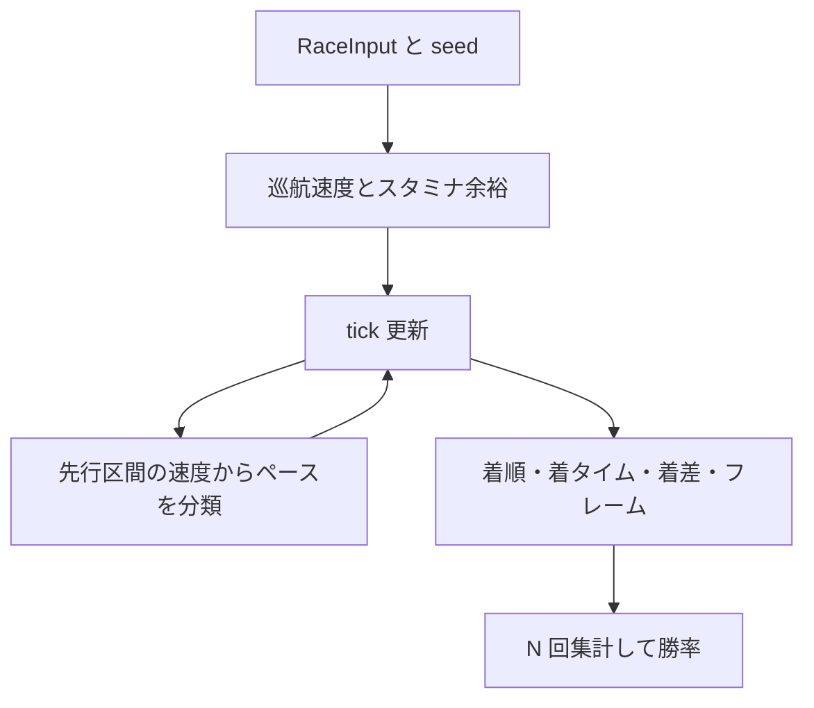

# 既存手法 PoC 検証仕様

| 項目 | 内容 |
|------|------|
| 文書名 | 既存手法 PoC 検証仕様（物理シミュレーション + Monte Carlo） |
| プロジェクト | KEIBA RACING SIMULATOR |
| 版 | 0.1.0 |
| 作成日 | 2026-10-18 |
| ステータス | PoC 仕様 |
| 関連 | [PoC 計画](./README.md)、[基本設計書](../basic-design/basic-design.md) 5 章、[提案手法](./proposed-method.md) |

---

## 1. 目的

基本設計 5 章のシミュレーションが、固定した式のもとで次を満たすことを検証する。

- 同一 seed で同一の着順・着タイムになる
- 能力の高低が、他条件を揃えたときに着順へ現れる
- ペースと脚質の組み合わせで、差し・追込と逃げの相対着差が動く
- 前が塞がる、外を回る、という相互作用が着順または着タイムに現れる
- Monte Carlo の勝率・3 着以内率・平均着順が、完全な着順の集計として整合する
- 着タイム、着差、再生用フレームが残る

係数は PoC で検証するための固定値であり、JRA の実タイムへ校正した値ではない。校正は基本設計 Phase 5 の作業である。

## 2. 手法

1 頭ずつ独立にスコアへ乱数を足して並べるのではなく、共通の時計の上で各馬の位置を更新する。順位は位置から決まる。Monte Carlo は、馬ごとの巡航速度へ試行単位の乱数を乗せたレースを N 回走らせ、着順を数える。



基本設計の対応は次のとおり。

| 基本設計 | この PoC |
|----------|----------|
| 5.2 能力計算 | 3 節の巡航速度とスタミナ |
| 5.3 ペース・位置更新 | 4 節の tick。dt は 0.1 秒 |
| 5.4 相互作用 | 5 節。検証用に無効化できる |
| 5.5 ペースシナリオ | 6 節。創発と強制の二モード |
| 5.6 乱数 | 7 節。試行の開始前に 1 頭 1 回だけ引く |
| 5.7 Monte Carlo | 8 節。予想モードはフレームを残さない |

## 3. 能力

属性 `speed`、`stamina`、`acceleration`、`cornering` は 0〜100、騎手 `skill` も 0〜100 とする。適性 `turf` と `dirt` は正の実数で、検証フィクスチャの中立値は 1 である。

### 3.1 巡航速度

```
fit = surfaceAptitude * distanceFit * goingFit * weightFit * jockeyFit

distanceFit = clamp(1 - 0.00012 * |distance - bestDistance|, 0.90, 1.0)
weightFit   = clamp(1 - 0.0025 * (weight - 55), 0.92, 1.05)
jockeyFit   = 0.97 + 0.06 * (skill / 100)
```

| going | goingFit |
|-------|----------|
| good | 1 |
| yielding | 0.99 |
| soft | 0.975 |
| heavy | 0.955 |

`surfaceAptitude` は当該 `surface` の適性である。

```
v_cruise = (13.2 + 0.048 * speed) * fit
```

`speed = 50` かつ `fit = 1` のとき 15.6 m/s、`speed = 100` のとき 18.0 m/s になる。検証で能力以外を消すときは、`bestDistance` をレース距離に合わせ、馬場は `good`、斤量は 55、騎手 skill は 50、適性は 1 にする。このとき `fit = 1` である。

試行乱数は 7 節の `multiplier` を掛けた `v_cruise_trial` を使う。tick の途中では引き直さない。

### 3.2 スタミナ

余力は距離に比例する努力で減る。`D` はレース距離（m）である。

```
R = D * (0.50 + 0.45 * stamina / 100)
```

移動のたびに `effort += (v / v_cruise_trial)² * progress_m` を足す。`v_cruise_trial` は正とする。

```
effort <= R のとき staminaFactor = 1
effort >  R のとき fade = (effort - R) / (0.25 * D)
                 staminaFactor = clamp(1 - 0.40 * fade, 0.55, 1)
```

`stamina = 100` の馬は終盤までほぼ巡航を維持し、`stamina = 20` の馬は距離の約 6 割を過ぎてから減速する。出力用の `staminaLeft` は、`effort <= R` なら 1、それ以外は `clamp(1 - fade, 0, 1)` とする。

### 3.3 出足

初速は `0.92 * v_cruise_trial` とする。加速度の上限は次のとおり。

```
a_max = 1.2 + 1.6 * (acceleration / 100)    // m/s²
```

1 tick の速度変化は `±a_max * dt` 以内とする。

## 4. tick

`dt = 0.1`。時刻 0 で全馬の走行距離は、フィクスチャが `initialDistance` を持たなければ 0 とする。レーンの初期値は枠番である。

各 tick では、更新前の走行距離が大きい順に馬を処理する。同距離では脚質の優先順 `front`、`stalk`、`mid`、`closer`、その次に小さい枠番、その次に小さい馬番とする。先に更新した馬の速度を、後続のブロック判定に使う。

目標速度は次の積である。各係数の定義は 5 節と 6 節に置く。無効化した項目の係数は 1 とする。

```
v_target = v_cruise_trial
         * staminaFactor
         * cornerFactor
         * scenarioFactor
         * positionFactor
         * earlyFactor
```

現在速度を、1 tick で `a_max` を超えない範囲で `v_target` へ近づける。その後にブロック上限を適用する。速度は 0 未満にしない。

コーナー区間の進行はレーンで割り引く。直線では割引しない。

```
path = コーナーなら 1 + 0.012 * (lane - 1)、直線なら 1
progress_m = v * dt / path
```

走行距離へ `progress_m` を足し、努力を更新し、レーン変更を反映し、最後に順位を付け直す。

コース形状は実在コースではなく、距離割合で固定した模式コースとする。`direction` は内側レーンの左右を決めるだけで、レーン 1 を内側とする。

| 距離割合 | 区間 |
|----------|------|
| [0.00, 0.40) | 直線 |
| [0.40, 0.55) | コーナー |
| [0.55, 0.75) | 直線 |
| [0.75, 0.90) | コーナー |
| [0.90, 1.00] | 直線 |

コーナーでは `cornerFactor = 1 - 0.05 * (1 - cornering / 100)`、直線では 1 とする。

ゴールは走行距離が `D` に達した tick で、その tick 内を線形補間する。

```
t_finish = time + (D - distance_before) / v
```

全馬がゴールした時点でその試行を終える。着順は着タイムの昇順、同着は小さい馬番を上位にする。

## 5. 相互作用

`options.interactions` の既定は true。false のときはブロック、レーン変更、コーナーの進路延長を行わない。

### 5.1 前が塞がる

自分より 0 m を超え 2.0 m 以内にいて、レーン差の絶対値が 0.75 未満の馬がいるとき、目標速度をその馬の当 tick 更新後速度以下にする。該当が複数なら最も近い馬を使う。

### 5.2 レーン変更

`options.allowLaneChange` の既定は true。ブロックされており、変更先レーンの ±3 m に馬がいないとき、内側が空いていれば内側へ、空いていなければ外側へ、1 秒あたり 1 レーン動く。1 tick では 0.1 レーンである。レーン番号の下限は 1、上限は `max(8, 最大枠番)` とする。

### 5.3 位置取り

`options.positionTactics` の既定は true。順位の相対位置 `positionFraction = (rank - 1) / max(n - 1, 1)` と、脚質の目標位置との差 `error = positionFraction - desired` を使う。`error` が正のときは目標より後ろにいる。

| 脚質 | desired | 仕掛けてよい残り割合 |
|------|---------|----------------------|
| front | 0.05 | 1.00 |
| stalk | 0.28 | 0.70 |
| mid | 0.55 | 0.45 |
| closer | 0.82 | 0.30 |

残り割合は `1 - distance / D` である。

```
positionFactor = 1 + 0.03 * clamp(error, -1, 1)
```

残り割合が仕掛け条件より大きく、かつ `error > 0` のときは、まだ仕掛けないので `positionFactor = 1` とする。結果は [0.97, 1.03] に収める。

## 6. ペース

### 6.1 前半の意図

`options.earlyIntent` の既定は true。走行距離が `0.35 D` 未満のとき、脚質と逃げ頭数で `earlyFactor` を付ける。以降は 1 とする。逃げ頭数 `nFront` は `runningStyle == front` の頭数である。

| 脚質 | nFront <= 1 | nFront >= 2 |
|------|-------------|-------------|
| front | 1.008 | min(1.06, 1.008 + 0.014 * (nFront - 1)) |
| stalk | 1.000 | 1.000 |
| mid | 0.995 | 0.995 |
| closer | 0.990 | 0.990 |

### 6.2 分類

`options.paceMode` は `emergent`（既定）または `forced` とする。

`emergent` では、先頭の走行距離が `0.12 D` を超えた時刻 `t0` と、`0.32 D` を超えた時刻 `t1` から前半速度を求める。先頭は各時点の更新後位置で判定する。

```
earlySpeed = (0.32 D - 0.12 D) / (t1 - t0)
ratio = earlySpeed / その時点の先頭馬の v_cruise_trial
```

| 条件 | シナリオ |
|------|----------|
| ratio >= 1.015 | high |
| ratio <= 0.993 | slow |
| それ以外 | average |

`forced` ではフィクスチャの `forcedScenario` を使い、上の分類は行わない。

### 6.3 シナリオ係数

分類点（先頭が `0.32 D` に到達した tick）以降、`scenarioFactor` を脚質に掛ける。それ以前は 1 とする。`forced` でも掛ける時点は同じである。

| シナリオ | front | stalk | mid | closer |
|----------|-------|-------|-----|--------|
| slow | 1.015 | 1.008 | 1.000 | 0.990 |
| average | 1 | 1 | 1 | 1 |
| high | 0.988 | 0.996 | 1.008 | 1.018 |

この係数は位置取りの `positionFactor` とは別に掛ける。ペースの持続を表し、仕掛けのタイミングは表さない。

## 7. 乱数

`Math.random` は使わない。各試行の馬ノイズは mulberry32 の 1 本のストリームから、馬 ID の昇順に引く。正規乱数は Box-Muller で対にして生成し、頭数が奇数のときは余った 1 個を捨てる。一様乱数が `1e-12` 未満のときは `1e-12` に上げてから対数を取る。

```
multiplier = clamp(1 + noiseSd * z, 0.94, 1.06)
v_cruise_trial = v_cruise * multiplier
```

`noiseSd` の既定は 0.015。機構テストで決定的にしたい項目は 0 にする。

seed の混合は次で固定する。`>>>` は 32 ビット符号なし右シフト、`imul` は 32 ビット整数乗算である。

```
mix(base, trial, channel) =
  x = (base + 0x9E3779B9 * (trial + 1) + channel) を uint32 にしたもの
  x = imul(x xor (x >>> 16), 0x7FEB352D)
  x = imul(x xor (x >>> 15), 0x846CA68B)
  return (x xor (x >>> 16)) の uint32

試行の馬ノイズ seed = mix(baseSeed, trialIndex, 1)
```

`trialIndex` は 0 始まりである。

## 8. Monte Carlo と出力

予想モードは `recordFrames: false`、試行回数 N の既定は 1,000、`baseSeed` の既定は `20261018` とする。試行 `k` のノイズ seed は `mix(baseSeed, k, 1)` である。

| 指標 | 計算 |
|------|------|
| winProb | 1 着だった試行数 / N |
| top3Prob | 着順が `min(3, n)` 以内だった試行数 / N |
| meanRank | 着順の算術平均 |

集計の恒等式は次のとおり。許容差は `1e-12` とする。

```
Σ winProb = 1
Σ top3Prob = min(3, n)
馬平均の meanRank = (n + 1) / 2
```

1 回のレース結果は次を含む。

| フィールド | 意味 |
|------------|------|
| finishOrder | 着順、馬 ID、`timeSec`、`marginSec`、`marginLengths` |
| checkpoints | 残り 800 m、600 m、400 m、200 m を先頭が通過したときの各馬順位。距離がそれより短い地点は省略する |
| frames | `recordFrames: true` のとき、各 tick の全馬の距離、速度、レーン、順位、`staminaLeft` |
| scenario | その試行の slow / average / high |

勝者の `marginSec` は 0。他馬は `timeSec` の差とする。`marginLengths = marginSec * 勝者のゴール時速度 / 2.5` とし、1 馬身を 2.5 m とおく。

再生モードは N = 1、`recordFrames: true` とする。フレームの時刻は 0 から dt 刻みで、最終フレームの順位は着順と一致する。

## 9. 検証項目

中立属性は 3.1 の `fit = 1` である。能力の数値を書かない馬は `speed = 70`、`stamina = 70`、`acceleration = 50`、`cornering = 80` とする。特に書かない項目のオプションは既定値、`noiseSd = 0`、距離 1,600、芝、良馬場、左回りとする。

| ID | 操作 | 合格 |
|----|------|------|
| E1 | 同一入力・同一 seed で予想を 2 回実行する | 全試行の着タイムと着順が一致する |
| E2 | 8 頭、N = 1,000 で集計する | 8 節の三つの恒等式を満たす |
| E3 | 2 頭。speed 80 と 55。他は同一。`interactions: false` | speed 80 が先着する |
| E4 | E3 と同じ 2 頭。`noiseSd = 0.015`、N = 1,000、seed `20261018` | speed 80 の勝率が 0.95 を超える |
| E5 | 2 頭。speed はどちらも 70。stamina 90 と 20。距離 2,500。`interactions: false`、`positionTactics: false` | stamina 90 が先着する |
| E6 | 2 頭の逃げ。speed は同一、acceleration 90 と 20。レーンは 1 と 2。`interactions: false` | 時刻 1.0 秒で acceleration 90 の走行距離が長い |
| E7 | 逃げ・先行・差し・追込を 1 頭ずつ、能力は同一。`interactions: false`、`positionTactics: false`。`paceMode: forced` で slow と high を各 1 回 | `(着タイムの追込 − 逃げ)` が high の方が slow より小さい |
| E8a | 逃げ 1、追込 7。能力は同一。`interactions: false`、`positionTactics: false`、`paceMode: emergent` | シナリオが average。ratio は 0.993 を超え 1.015 未満 |
| E8b | 逃げ 3、追込 5。他は E8a と同じ | シナリオが high。ratio は 1.015 以上 |
| E8c | 追込 8。他は E8a と同じ | シナリオが slow。ratio は 0.993 以下 |
| E9a | 同一レーン。speed 60 の馬の初期距離 1 m、speed 85 の馬は 0 m。stamina はどちらも 80。`allowLaneChange: false`、`positionTactics: false` | speed 60 が先着する |
| E9b | E9a で `allowLaneChange: true`。隣レーンは空いている | speed 85 が先着する |
| E10 | 能力が同一の 2 頭をレーン 1 とレーン 8 に固定する。`allowLaneChange: false`、`positionTactics: false`、`earlyIntent: false`、シナリオは forced average | レーン 1 の着タイムがレーン 8 より小さい |
| E11 | 同一馬で 1,200 m と 1,600 m を 1 回ずつ。`interactions: false` | 1,200 m の着タイムが 1,600 m より小さい |
| E12 | 8 頭の 1 回走行 | 勝者の marginSec が 0、全馬の marginSec が 0 以上、着順が着タイムの昇順と一致する |
| E13 | `recordFrames: true` で 1 回走行 | フレーム時刻が dt 刻み、各フレームに全馬がおり、最終順位が着順と一致する |
| E14 | 能力が完全に同一の 2 頭。`interactions: false`、`positionTactics: false`、`earlyIntent: false`、`noiseSd = 0.015`、N = 2,000 | 両馬の勝率がともに 0.42 以上 0.58 以下 |

E4 の速度差は約 7.6% で、速度ノイズの標準偏差 1.5% に対して十分大きい。E14 は、ノイズが馬の間で別々に引かれていることを見る。コーナー差と位置取りを切ってあるので、勝率の中心は 0.5 である。

E8 の ratio は 6.2 の定義そのものである。逃げ 1 頭の前半係数は 1.008、逃げ 3 頭は 1.036、追込だけの先頭は 0.990 であり、分類窓に入る前に加速が終わる。

## 10. 合格

E1〜E14 がすべて合格であること。X2 を実施する場合は、`dgp-sim` の生成に使った係数を予測側と揃える。生成器だけ係数を変えた log loss は、この文書の合格条件にしない。

## 11. この PoC で見ないもの

- 実在コースの緯度経度、高低差、コーナー半径
- 実レースへの係数当てはめ
- オッズを使った確率の補正
- 提案手法との実レース上の優劣。データが用意されたときに PoC 計画 6 節の表へ記録する

---

## 改訂履歴

| 版 | 日付 | 内容 |
|----|------|------|
| 0.1.0 | 2026-10-18 | 初版。PoC 用の固定式、出力、E1〜E14 |
