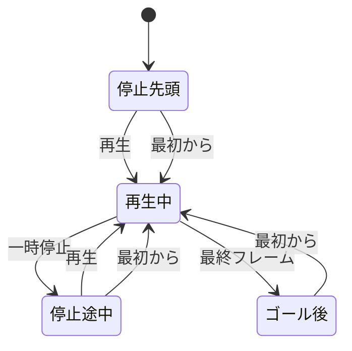

# UI 設計書（ワイヤーフレーム）

| 項目 | 内容 |
|------|------|
| 文書名 | UI 設計書（ワイヤーフレーム） |
| プロジェクト | KEIBA RACING SIMULATOR |
| 版 | 0.3.0 |
| 作成日 | 2026-10-22 |
| ステータス | ワイヤーフレーム |
| 関連 | [基本設計書](../basic-design/basic-design.md) 3 章・6 章・8 章 |

画面の領域、文言、操作の有効条件を決める。色、書体、余白の最終値、コースや馬の質感は決めない。プロトタイプ実装後の画面キャプチャを見てビジュアルを決める。

基本設計 3 章の暗い緑・灰・白は、キャプチャ前に画面を読めるようにするための仮の塗りである。

---

## 1. 画面

ページは 1 つ。対象は 1920×1080 のデスクトップブラウザで、このサイズに全領域が収まり、スクロールバーは出さない。

見出し、ボタン、時刻、順位は DOM に置く。Canvas に描くのはコースと馬だけとする。俯瞰と直線走行は、それぞれ別の Canvas にする。

```
┌─ A 見出し ─────────────────────────┬─ D 順位 / 着順 ─┐
│ 芝 1600m　左回り                    │                 │
├─ B コース ─────────────────────────┤                 │
│                                    │                 │
│         （Canvas・俯瞰）            │                 │
│                                    │                 │
├─ E 直線走行 ───────────────────────┼─ C 操作 ───────┤
│      （Canvas・前後と内外）         │ [再生] [一時停止] │
│                                    │ 経過  先頭の残り │
└────────────────────────────────────┴─────────────────┘
```

| 領域 | 役割 |
|------|------|
| A | レース条件の見出し。固定文「芝 1600m　左回り」 |
| B | コース全体の俯瞰と馬。画面の主領域。見出しの下、E の上の残りを使う |
| E | 直線に開いた走行位置。横が走行距離、縦がレーン。B の直下。幅は B と同じ |
| C | 再生操作と、経過・先頭の残り。D の下に置く |
| D | 走行中は現在順位。全馬ゴール後は着順。右列の上。下端は C の上 |

D は 8 行が折り返しとスクロールなしで入る幅にする。右列の下端は左列の下端に揃える。C は D の上には置かない。順位をコースの横に残すためである。

---

## 2. ワイヤーの読み方

| 記法 | 意味 |
|------|------|
| `[ラベル]` | 押せる |
| `[-ラベル-]` | 押せない |
| `〈ラベル〉` | 選択中 |
| 順位表の数値 | 列の並びを示す例。シミュレーション結果ではない |

速度の初期選択は `〈1x〉`。一時停止中や最初からのあとにも、選択は維持する。

---

## 3. 停止（先頭）

初期状態。シミュレーション時刻 0、再生は止まっている。同じ距離なので順位は馬番の昇順、先頭との差はすべて 0m。

```
┌────────────────────────────────────┬──────────────────────────┐
│ 芝 1600m　左回り                    │ 順位                      │
├────────────────────────────────────┼──────────────────────────┤
│                                    │ 順位 馬番 馬名     脚質 差 │
│                                    │ 1    1   イチバン  逃   0m │
│              コース                 │ 2    2   ニシキ    先   0m │
│                                    │ 3    3   ミハル    先   0m │
│                                    │ 4    4   ヨンカ    差   0m │
│                                    │ 5    5   イツキ    差   0m │
│                                    │ 6    6   ムツキ    追   0m │
│                                    │ 7    7   ナナセ    追   0m │
│                                    │ 8    8   ヤエ      逃   0m │
├────────────────────────────────────┼──────────────────────────┤
│ 直線（スタート地点で内外に並ぶ）      │ [再生] [-一時停止-] [最初から] │
│                                    │ 速度  〈1x〉 [2x] [4x]    │
│                                    │ 経過 0:00.0  残り 1600m   │
└────────────────────────────────────┴──────────────────────────┘
```

一時停止は、止まっているので押せない。

---

## 4. 再生中

再生クロックが進む。順位はフレームの `rank` 順。差は先頭馬の走行距離との差をメートルの整数で出す。先頭行は 0m。

```
┌────────────────────────────────────┬──────────────────────────┐
│ 芝 1600m　左回り                    │ 順位                      │
├────────────────────────────────────┼──────────────────────────┤
│                                    │ 順位 馬番 馬名     脚質 差 │
│                                    │ 1    1   イチバン  逃   0m │
│              コース                 │ 2    2   ニシキ    先   4m │
│           （馬が移動する）            │ 3    8   ヤエ      逃  11m │
│                                    │ 4    4   ヨンカ    差  18m │
│                                    │ 5    3   ミハル    先  22m │
│                                    │ 6    5   イツキ    差  27m │
│                                    │ 7    6   ムツキ    追  35m │
│                                    │ 8    7   ナナセ    追  41m │
├────────────────────────────────────┼──────────────────────────┤
│ 直線（前後と内外が開いて進む）        │ [-再生-] [一時停止] [最初から] │
│                                    │ 速度  〈1x〉 [2x] [4x]    │
│                                    │ 経過 0:12.4  残り 1412m   │
└────────────────────────────────────┴──────────────────────────┘
```

再生中は再生を押せない。一時停止でこのフレームの位置に止まる。速度を切り替えても位置は飛ばない。

---

## 5. ゴール後

最終フレームで再生が止まる。D の見出しが「着順」に替わり、列がタイムと着差になる。1 着の着差は空欄。タイムは `m:ss.s`、着差は馬身で小数 1 桁。

```
┌────────────────────────────────────┬──────────────────────────┐
│ 芝 1600m　左回り                    │ 着順                      │
├────────────────────────────────────┼──────────────────────────┤
│                                    │ 着順 馬番 馬名     タイム   着差 │
│                                    │ 1    2   ニシキ    1:40.2       │
│         コース（全馬ゴール後）        │ 2    7   ナナセ    1:40.5  1.8 │
│                                    │ 3    4   ヨンカ    1:40.7  3.1 │
│                                    │ 4    1   イチバン  1:40.9  4.4 │
│                                    │ 5    6   ムツキ    1:41.2  6.0 │
│                                    │ 6    3   ミハル    1:41.4  7.2 │
│                                    │ 7    5   イツキ    1:41.8  9.5 │
│                                    │ 8    8   ヤエ      1:42.1 11.3 │
├────────────────────────────────────┼──────────────────────────┤
│ 直線（ゴール板を過ぎた位置）          │ [-再生-] [-一時停止-] [最初から] │
│                                    │ 速度  〈1x〉 [2x] [4x]    │
│                                    │ 経過 1:42.4  残り 0m      │
└────────────────────────────────────┴──────────────────────────┘
```

上表の着順とタイムは列の例である。実装の着順は `simulate` の結果をそのまま出す。

最終フレームでは再生も一時停止も押せない。最初からで時刻 0 に戻り、D を「順位」に戻して再生する。

---

## 6. コース（領域 B）

Canvas の中の配置。線の太さや色は仮実装とし、キャプチャ後に決める。

```
                    向正面（画面上・左から右）
              ┌────────────────────────────┐
              │                            │
  第1・第2    │                            │  第3・第4
  コーナー    │          内場               │  コーナー
              │                            │
              └──────────┬─────────────────┘
                    ゴール板              スタンド前（画面下・右から左）
                    （スタート兼ゴール）
```

| 描くもの | 内容 |
|----------|------|
| 芝の帯 | レーン 1 の内側からレーン 5 の外側まで |
| 内柵・外柵 | 帯の内側と外側 |
| ゴール板 | 距離 0 の地点。スタンド前直線の左端で、レーン 1 から 5 を横切る |
| 馬 | 円の中に馬番。進行方向へ短い線。8 頭 |
| 馬名 | 描かない。D に出す |

馬の識別色はサンプルデータの `color` を使う。UI のテーマ色とは別にし、キャプチャ後に読みにくければ変える。

重なった馬は、画面上で下にある馬を手前に描く。馬番が読めることはキャプチャで確認する。

---

## 7. 直線走行（領域 E）

領域 B の俯瞰とは別に、走行距離を横、レーンを縦にした直線図を B の直下に置く。レース映像のトラッキングのように、隊列の前後と内外を同時に見るための領域である。操作は置かない。線の太さや色は仮実装とし、キャプチャ後に決める。

```
        ゴール方向 →
 内 ┌──────────────────────────────┐
    │ (8)    (3)(1)                │
    │    (5)     (2) (4)           │
    │       (6)       (7)          │
 外 └──────────────────────────────┘
      800        600         400
```

上の数値は残り距離の例である。馬は右へ進む。

| 描くもの | 内容 |
|----------|------|
| 芝の帯 | 横一直線。上端が内、下端が外 |
| 内柵・外柵 | 帯の上端と下端。左外に「内」「外」 |
| 距離目盛り | 表示範囲に入る目盛り。ラベルは残り距離（m）。範囲の幅に応じて 100 / 50 / 20 / 10m |
| スタート | 距離 0 が範囲内のとき、白い縦線 |
| ゴール板 | 距離 1600 が範囲内のとき、俯瞰と同じ白赤の縦線。上に「ゴール」 |
| 進行 | ゴール板が範囲外のとき、右上に「ゴール →」 |
| 馬 | 俯瞰と同じ円、馬番、進行方向の短い線。横は走行距離、縦はレーン。進行は右。8 頭 |
| 馬名 | 描かない。D に出す |

表示範囲は全馬が入る窓とする。先頭と最後尾の中央を窓の中央に置く。窓の幅は、隊列の長さと 40m の大きい方に、前後 6m を足した幅にする。先頭の走行距離が 1500m 以上のときは、ゴール板と全馬が収まるまで右端を延ばす。右端は走行距離 1650m を超えない。ゴール後に最大 50m 進んだ馬も範囲に含める。

補間は俯瞰と同じ。重なった馬は、画面上で下にある馬を手前に描く。

---

## 8. 操作の状態



| 状態 | 再生 | 一時停止 | 最初から | D |
|------|------|----------|----------|---|
| 停止（先頭） | 押せる | 押せない | 押せる。時刻 0 から再生 | 順位 |
| 再生中 | 押せない | 押せる | 押せる。時刻 0 から再生 | 順位 |
| 停止（途中） | 押せる | 押せない | 押せる。時刻 0 から再生 | 順位 |
| ゴール後 | 押せない | 押せない | 押せる。時刻 0 から再生 | 着順 |

速度はどの状態でも切り替えられる。再生中に切り替えたときは、その時点の位置から新しい倍率で進む。

経過は再生クロックを `m:ss.s` で出す。先頭の残りは `max(0, 1600 - 先頭の走行距離)` の整数メートルで、単位「m」を付ける。

---

## 9. キャプチャで決めること

プロトタイプが 3 節から 5 節の状態を一通り出せるようになったら、各状態の画面をキャプチャし、次を決める。決定欄は空のまま残す。

| 項目 | 見る状態 | 決定 |
|------|----------|------|
| ページ背景、パネル、文字の色 | 停止（先頭） | |
| ボタンの形、押せる / 押せない / 選択中の区別 | 再生中、ゴール後 | |
| コースの塗り、柵、ゴール板 | 停止（先頭） | |
| 直線図で前後と内外が読めるか | 再生中 | |
| 馬の形と、重なったときの馬番の読みやすさ | 再生中 | |
| 順位と着順の切り替わりが分かるか | ゴール後 | |
| 1 着行を他の行と分けるか | ゴール後 | |
| サンプルの馬色を維持するか | 再生中 | |

---

## 10. 画面に置かないもの

出走表の編集、勝率、グラフ、コース切替、メニュー、設定画面は置かない。

---

## 改訂履歴

| 版 | 日付 | 内容 |
|----|------|------|
| 0.1.0 | 2026-10-22 | ワイヤーフレームを作成。ビジュアルはキャプチャ後に決める |
| 0.2.0 | 2026-10-22 | 俯瞰の下に、直線の走行状況（領域 E）を追加 |
| 0.3.0 | 2026-10-22 | 1920×1080 の 1 画面に収め、操作を順位の下へ移す |
